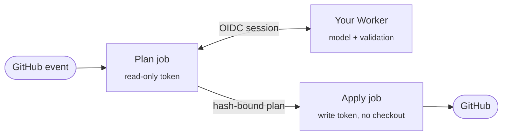

<p align="center">
   
</p>

<h3 align="center">Your repositories, tended.</h3>

<p align="center">
  AI maintainers for GitHub that can triage issues, answer @mentions, merge Dependabot PRs and
  catch stale docs, without ever holding a write token.
</p>

<p align="center">
  <a href="https://www.npmjs.com/package/@scuffi/gardener"></a>
  <a href="LICENSE"></a>
  <a href="https://gardener.scuffi.dev/"></a>
  
</p>

<p align="center">
  <a href="https://gardener.scuffi.dev/getting-started"><b>Get started</b></a> ·
  <a href="https://gardener.scuffi.dev/task-authoring">Write a task</a> ·
  <a href="https://gardener.scuffi.dev/task-reference">Reference</a> ·
  <a href="SECURITY.md">Security</a>
</p>

---

Each Gardener task is one Markdown file. It sets what event starts the task, what the model may
read, and the exact list of changes it may make, followed by instructions in plain English. The
task compiles to a GitHub Actions workflow, and the model runs on a Cloudflare Worker in your own
account. A separate job makes the changes, and only the ones the task declared.

## Get it running

```bash
npx @scuffi/gardener yolo --workspace my-gardener --repository my-org/my-repo --demos
```

Run this from a checkout of your default branch. In one go, it:

1. scaffolds `.gardener/` with two demo tasks;
2. compiles them into `.github/workflows/`;
3. deploys the Worker and its D1 database to your Cloudflare account;
4. enrolls the repository;
5. checks that the install works.

It's safe to rerun, and it never commits:

```bash
git add .gardener .github/workflows && git commit -m "Add Gardener" && git push
```

Then open an issue labeled `gardener-bug`. Gardener reacts with 👀 while it works and 🚀 once its
comment lands.

You'll need Node.js 24+, `npx wrangler login` and `gh auth login`.
[Getting started](https://gardener.scuffi.dev/getting-started) covers the rest, plus a
step-by-step version that takes about ten minutes.

## What will you grow?

These are the tasks that maintain this repository. Copy one into `.gardener/tasks/` and adapt it.

| | Task | What it does | Runs |
| --- | --- | --- | --- |
| 🐛 | [Triage](.gardener/tasks/triage/TASK.md) | Labels new issues with existing labels, links likely duplicates, closes empty or invalid ones | issue opened |
| 💬 | [Mention reply](.gardener/tasks/mention-reply/TASK.md) | A maintainer mentions the bot and it does what was asked: answers, reviews, pushes a fix, opens a PR | on mention |
| 🤖 | [Dependabot merge](.gardener/tasks/dependabot-merge/TASK.md) | Merges Dependabot PRs whose checks all passed, flags the rest for a person | every 4 hours |
| 📚 | [Docs review](.gardener/tasks/docs-review/TASK.md) | Reads the docs against the code and opens one issue listing what's out of date | Mondays |
| 🧪 | [Examples review](.gardener/tasks/examples-review/TASK.md) | Runs the examples and opens a draft PR fixing the ones that broke | Mondays |
| 🔍 | [Test coverage review](.gardener/tasks/test-coverage-review/TASK.md) | Finds important behaviour with no tests and opens an issue about it | Mondays |

## A task is one file

```markdown
---
schema: gardener.task/v1
id: triage
name: Triage
description: Summarises new issues, points out likely duplicates, and applies existing labels.
trigger:
  event: github.issue.opened
tools: [repository.list_files, repository.read_file, provider.api.read]
effects: [issue.comment.create, issue.label.add]
network: { default: deny, allow: [], deny: [] }
limits: { runtime-seconds: 300, max-turns: 12, max-tool-calls: 16, input-tokens: 80000, output-tokens: 16000 }
---
Triage the issue that triggered this run. Search for similar open issues, then comment with a
short summary, link any likely duplicate, and add up to two existing labels that fit.
```

Save it as `.gardener/tasks/triage/TASK.md`, run `npx @scuffi/gardener generate`, and push.

`effects` does real work here. The model can propose only these two kinds of change, and the
generated workflow asks GitHub for only the token permissions they need. Whatever ends up in the
prompt, this task can't close an issue or push a commit.

Don't want to write YAML? `init` drops a `.gardener/SKILL.md` into your repo that teaches coding
agents the whole task format, so you can ask yours for "a task that labels stale PRs every Friday".

## What tasks can do

- **React to 29 kinds of event**: issues, pull requests, reviews, review comments, discussions,
  pushes, cron schedules and manual runs. You can narrow each trigger by label, by author
  (`authors: maintainers`) or by who's mentioned.
- **Make 36 kinds of change**: comments, labels, assignees, reviews, replying to and resolving
  review threads, branches, commits, opening PRs and drafts, merges, check reruns and releases.
- **Use the model you want**: Workers AI by default (`@cf/zai-org/glm-5.3`), or set
  `model: anthropic/…` or `model: openai/…` per task, routed through
  [AI Gateway](https://gardener.scuffi.dev/operations#ai-gateway).
- **Stay on budget**: each run has caps on runtime, turns, tool calls and tokens. Each task can also
  cap how often it runs: outsiders get 3 runs a day by default, and a run over the cap is skipped
  before the model is called.
- **Post to chat**: `message.send` pings Slack or Google Chat.
- **Leave a paper trail**: `gardener runs view` prints every step of a run, the receipt for each
  change it made, and the audit log. `gardener repository disable` blocks every task in a repo
  immediately.

## Why it's safe to give it write access

Every task compiles to a workflow with two jobs, and no job ever gets both the model and a
write token.



- **Plan** checks out the repo with a read-only token. The model looks around using only the tools
  the task declares and proposes changes. The Worker validates each proposal and returns an exact
  plan, bound to a hash.
- **Apply** never checks out or runs repository code. It verifies the plan's hash with the Worker,
  then makes each change in order. Before each write it checks that GitHub still looks the way it
  did at planning time. If something has moved, it stops rather than overwrite it.

A few more properties:

- **Strangers can't redirect it.** Who started a run decides where the run may act, and Gardener
  works that out from GitHub-signed data before the model sees anything. Runs started by outsiders,
  bots or forked branches can touch only the issue or PR that triggered them, and they can never
  merge or approve a PR they opened.
- **Nothing to leak.** There's no GitHub App, webhook, personal access token or stored GitHub
  secret. Each session needs a fresh GitHub OIDC token, pinned to the repository, the run, the
  commit and the exact reusable-workflow commit.
- **It runs on your accounts.** The Worker, the database and the model bill run on your
  Cloudflare account. The workflows live in your repo.

The full threat model is in [SECURITY.md](SECURITY.md), and the protocol is in
[Architecture](https://gardener.scuffi.dev/architecture).

## Heads up: it's early

Gardener is pre-release, so keep these in mind:

- **No approval step.** Declared effects apply automatically. If a task declares
  `pull_request.merge`, it will merge. Declare the narrowest effects you can.
- **`repository.exec` has normal network access.** It runs commands with the runner's usual
  internet access. Keep it away from sensitive private code.
- **Limited live testing.** Only the issue-comment path has been tested end to end against real
  GitHub. Everything else passes the test suite but hasn't been proven live yet.

## Docs

Everything else is at **[gardener.scuffi.dev](https://gardener.scuffi.dev/)**.

| Page | What's in it |
| --- | --- |
| [Getting started](https://gardener.scuffi.dev/getting-started) | Deploy and run your first task |
| [Onboarding](https://gardener.scuffi.dev/onboarding) | Connecting repositories, starter tasks, upgrading |
| [Creating tasks](https://gardener.scuffi.dev/task-authoring) | Choosing triggers, effects, limits and effect scope |
| [Task reference](https://gardener.scuffi.dev/task-reference) | Every key, trigger, tool, effect and limit |
| [CLI reference](https://gardener.scuffi.dev/cli) | Every command and flag |
| [Operations](https://gardener.scuffi.dev/operations) | Deploying, Cloudflare Access, AI Gateway, spend caps, kill switch |
| [Architecture](https://gardener.scuffi.dev/architecture) | Components, data, and the plan/apply protocol |

Coding agents can read the docs as [`llms.txt`](https://gardener.scuffi.dev/llms.txt) or
[`llms-full.txt`](https://gardener.scuffi.dev/llms-full.txt).

## Contributing

Issues and ideas are welcome. Start with [CONTRIBUTING.md](CONTRIBUTING.md). If you're working on
Gardener itself, the [collaborator guide](COLLABORATORS.md) covers setup, the repo layout and
`pnpm check`.

To report a vulnerability, use GitHub's private vulnerability reporting, as described in
[SECURITY.md](SECURITY.md).

## License

[MIT](LICENSE). Go grow something.
